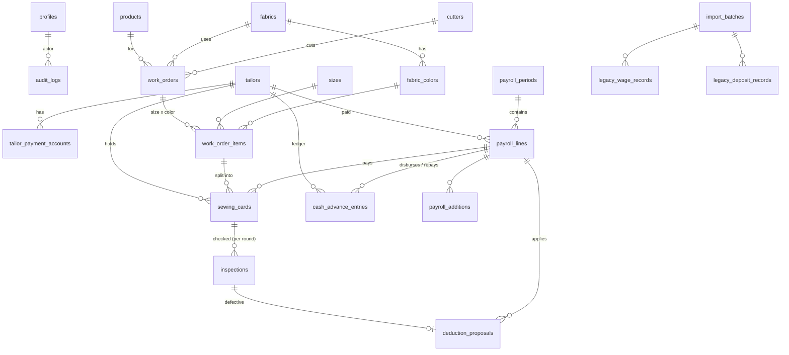

# Desain Database (Supabase / Postgres)

|        |                                                                          |
| ------ | ------------------------------------------------------------------------ |
| Status | v1 — sudah diimplementasikan di `supabase/migrations/`                   |
| Acuan  | `docs/PRD.md` (Draft v3), konvensi di `README.md` § Database conventions |

Konvensi yang dipakai: nama tabel jamak `snake_case` (bahasa Inggris), PK
`id uuid default gen_random_uuid()`, FK `<tabel_tunggal>_id`, `created_at` di
semua tabel, `updated_at` di tabel yang bisa diedit. **RLS aktif di semua tabel.**

## 1. Glosarium (istilah lapangan → nama tabel)

| Istilah                                      | Tabel                                                             |
| -------------------------------------------- | ----------------------------------------------------------------- |
| Pengguna aplikasi                            | `profiles`                                                        |
| Penjahit / anak jahit                        | `tailors`                                                         |
| Rekening / e-wallet penjahit                 | `tailor_payment_accounts`                                         |
| Tukang potong                                | `cutters`                                                         |
| Produk / model (kode produk)                 | `products`                                                        |
| Bahan                                        | `fabrics`                                                         |
| Warna bahan                                  | `fabric_colors`                                                   |
| Ukuran (MIDI, …)                             | `sizes`                                                           |
| Tarif upah S/M/L                             | `wage_rates`                                                      |
| WO                                           | `work_orders`                                                     |
| Baris WO per ukuran × warna (+ hasil potong) | `work_order_items`                                                |
| Kartu jahit (kertas 6×10)                    | `sewing_cards`                                                    |
| Pemeriksaan finishing                        | `inspections`                                                     |
| Usulan potongan rusak permanen               | `deduction_proposals`                                             |
| Kasbon, cicilan, kerugian (buku kasbon)      | `cash_advance_entries`                                            |
| Periode gajian (Senin–Sabtu)                 | `payroll_periods`                                                 |
| Gaji per penjahit per periode                | `payroll_lines`                                                   |
| Tambahan gaji (THR, bonus)                   | `payroll_additions`                                               |
| Riwayat impor                                | `import_batches`, `legacy_wage_records`, `legacy_deposit_records` |
| Jejak perubahan                              | `audit_logs`                                                      |
| Anti tap-ganda                               | `idempotency_keys`                                                |
| Kalibrasi printer                            | `print_settings`                                                  |

## 2. Diagram relasi



## 3. Enum

| Enum                      | Nilai                                                                                                               |
| ------------------------- | ------------------------------------------------------------------------------------------------------------------- |
| `app_role`                | `master` (semua hak — dev & testing), `production_head`, `finishing_head`, `warehouse`, `owner`, `cutter`, `tailor` |
| `tailor_status`           | `active`, `inactive` (nilai lama `left` tidak dipakai lagi, dicegah constraint)                                     |
| `payment_account_type`    | `bank`, `ewallet`                                                                                                   |
| `wage_category`           | `S`, `M`, `L`                                                                                                       |
| `change_status`           | `changed` (ADA PERUBAHAN), `follow_sample` (TIDAK ADA PERUBAHAN / IKUT SAMPEL)                                      |
| `work_order_status`       | `draft`, `cutting`, `sewing`, `done`, `cancelled`                                                                   |
| `sewing_card_status`      | `taken`, `submitted`, `paid`, `cancelled`                                                                           |
| `inspection_status`       | `pending`, `in_repair`, `done`                                                                                      |
| `deduction_decision`      | `pending`, `deduct`, `waive`                                                                                        |
| `cash_advance_entry_type` | `opening_balance`, `advance`, `repayment`, `write_off`                                                              |
| `payroll_period_status`   | `open`, `locked`                                                                                                    |
| `payroll_line_status`     | `draft`, `paid`                                                                                                     |
| `import_source`           | `tailor_data`, `weekly_deposit`                                                                                     |

Semua nominal uang bertipe **`bigint` (Rupiah utuh)**, selalu `>= 0`; arah
(tambah/kurang) ditentukan oleh jenis kolom/entri, bukan tanda minus.
Tanggal kerja (`*_on`) bertipe `date` dalam WIB; waktu kejadian (`*_at`)
bertipe `timestamptz`.

## 4. Tabel

### 4.1 Pengguna

**`profiles`**

| Kolom                  | Tipe        | Aturan                                                                             |
| ---------------------- | ----------- | ---------------------------------------------------------------------------------- |
| id                     | uuid        | PK, FK → `auth.users.id`                                                           |
| username               | text        | unik, lowercase, `^[a-z0-9_]{3,20}$`                                               |
| display_name           | text        | not null                                                                           |
| role                   | app_role    | **null = belum punya akses**; diisi manual (SQL/dashboard) untuk pengguna yang sah |
| is_active              | boolean     | default true                                                                       |
| created_at, updated_at | timestamptz |                                                                                    |

Dibuat otomatis oleh trigger `handle_new_user()` (lihat README § Authentication).

### 4.2 Master data

**`tailors`** — penjahit

| Kolom                  | Tipe          | Aturan                                           |
| ---------------------- | ------------- | ------------------------------------------------ |
| id                     | uuid          | PK                                               |
| code                   | text          | **unik**, not null — kode penjahit (mis. `29`)   |
| name                   | text          | not null                                         |
| phone                  | text          | null                                             |
| status                 | tailor_status | default `active`                                 |
| left_on                | date          | wajib jika `status = left`                       |
| notes                  | text          |                                                  |
| profile_id             | uuid          | FK → profiles, null (untuk login penjahit nanti) |
| created_at, updated_at | timestamptz   |                                                  |

Fungsi `find_similar_tailors(name)` memakai jarak edit (`fuzzystrmatch`) + trigram (`pg_trgm`) → peringatan nama mirip (DIDI/DINDI, BIDIN/JIDIN).

**`tailor_payment_accounts`** — rekening / e-wallet

| Kolom          | Tipe                 | Aturan                                             |
| -------------- | -------------------- | -------------------------------------------------- |
| id             | uuid                 | PK                                                 |
| tailor_id      | uuid                 | FK → tailors                                       |
| account_type   | payment_account_type |                                                    |
| provider       | text                 | mis. `SeaBank`, `DANA`                             |
| account_number | text                 | disimpan hanya digit (spasi dibuang)               |
| account_holder | text                 | atas nama                                          |
| is_active      | boolean              | **unik parsial**: satu rekening aktif per penjahit |
| created_at     | timestamptz          |                                                    |
| deactivated_at | timestamptz          | null                                               |

Rekening lama tidak dihapus, hanya dinonaktifkan (riwayat). Index biasa pada
`account_number` → peringatan "nomor sudah dipakai penjahit lain".

**`cutters`** — tukang potong: `id`, `name` (unik), `is_active`, `created_at`, `updated_at`.

**`products`**

| Kolom                  | Tipe          | Aturan                                                  |
| ---------------------- | ------------- | ------------------------------------------------------- |
| id                     | uuid          | PK                                                      |
| code                   | text          | **unik** (case-insensitive) — mis. `W-133 BLS`          |
| name                   | text          | null                                                    |
| wage_category          | wage_category | null boleh saat dibuat; **wajib** sebelum dipakai di WO |
| sample_photo_public_id | text          | Cloudinary public id                                    |
| is_active              | boolean       |                                                         |
| created_at, updated_at | timestamptz   |                                                         |

`default_pattern_id` (FK → patterns, null, `on delete set null`) — kode pola
yang otomatis terpilih saat membuat WO produk ini.

**`patterns`** — kode pola: `id`, `code` (unik, mis. `P-133`), `notes`, `is_active`, timestamps.
**`fabrics`** — `id`, `name` (unik, mis. `BLACK SWAN`), `is_active`, timestamps. Dipakai
sebagai bahan utama **dan** bahan kombinasi WO.
**`fabric_series`** — seri bahan: `id`, `fabric_id`, `name` (mis. `SERI 1`), `is_active`;
unik per bahan. Satu bahan bisa punya beberapa seri, masing-masing dengan
daftar warna sendiri.
**`fabric_colors`** — `id`, `series_id`, `fabric_id` (diisi otomatis dari seri), `name`;
unik per seri (warna yang sama boleh ada di seri lain).
**`sizes`** — `id`, `name` (unik, mis. `MIDI`), `sort_order`.

**Keseragaman penulisan.** Trigger `normalize_labels` merapikan setiap simpan:
kode/nama master (produk, pola, bahan, warna, ukuran, tukang potong, nama
penjahit) jadi HURUF BESAR dengan spasi tunggal; nama model produk dan catatan
hanya dirapikan spasinya. Keunikan memakai `label_key()` (huruf kecil, hanya
a–z dan 0–9), jadi `BLACK SWAN`, `black-swan`, dan `BlackSwan` dianggap
**data yang sama** dan ditolak sebagai duplikat. Akibatnya WO dan kartu jahit
cukup memilih dari daftar, tidak ada ketik ulang.

**Tambah otomatis dari form WO.** Form WO boleh diketik bebas dengan saran
dari master data. Fungsi `ensure_master_label(kind, label, parent)` (khusus
Kepala Produksi) mencari data dengan `label_key()` yang sama; jika ada dipakai
(dan diaktifkan kembali bila nonaktif), jika belum ada dibuat. Berlaku untuk
produk, bahan (termasuk kombinasi), tukang potong, kode pola, ukuran, dan warna
per bahan. `suggest_work_order_number_for_label(label)` mengusulkan nomor WO
dari kode produk yang diketik, termasuk produk baru.

**`wage_rates`** — tarif per kategori, tidak pernah ditimpa

| Kolom          | Tipe          | Aturan                                   |
| -------------- | ------------- | ---------------------------------------- |
| id             | uuid          | PK                                       |
| wage_category  | wage_category |                                          |
| amount         | bigint        | > 0 (S = 20.000, M = 25.000, L = 30.000) |
| effective_from | date          | unik bersama `wage_category`             |
| created_by     | uuid          | FK → profiles                            |
| created_at     | timestamptz   |                                          |

Fungsi `wage_rate_on(category, date)` → tarif yang berlaku pada tanggal itu.

### 4.3 Work order

**`work_orders`**

| Kolom                  | Tipe              | Aturan                                                                       |
| ---------------------- | ----------------- | ---------------------------------------------------------------------------- |
| id                     | uuid              | PK                                                                           |
| number                 | text              | **unik**; default `WO_<kode_produk>`, `_2`, `_3` bila sudah ada; bisa diedit |
| ordered_on             | date              | tanggal WO                                                                   |
| product_id             | uuid              | FK → products (kategori wajib terisi)                                        |
| pattern_id             | uuid              | FK → patterns, null; default = pola bawaan produk                            |
| fabric_id              | uuid              | FK → fabrics                                                                 |
| fabric_series_id       | uuid              | FK → fabric_series milik `fabric_id`; warna item harus dari seri ini         |
| fabric_combination_id  | uuid              | FK → fabrics, null; tidak boleh sama dengan `fabric_id`                      |
| cutter_id              | uuid              | FK → cutters                                                                 |
| change_status          | change_status     |                                                                              |
| change_notes           | text              | wajib jika `changed`                                                         |
| additional_info        | text              | info lebih lanjut                                                            |
| sample_photo_public_id | text              | Path foto sampel di bucket privat `work-order-photos` (Supabase Storage)     |
| status                 | work_order_status | diperbarui oleh fungsi, bukan diisi manual                                   |
| created_by             | uuid              | FK → profiles                                                                |
| created_at, updated_at | timestamptz       |                                                                              |

**`work_order_items`** — satu baris per ukuran × warna di WO

| Kolom                  | Tipe        | Aturan                                    |
| ---------------------- | ----------- | ----------------------------------------- |
| id                     | uuid        | PK                                        |
| work_order_id          | uuid        | FK                                        |
| size_id                | uuid        | FK → sizes                                |
| fabric_color_id        | uuid        | FK → fabric_colors (harus milik bahan WO) |
| cut_quantity           | integer     | null sebelum dipotong, lalu > 0           |
| created_at, updated_at | timestamptz |                                           |

Unik (`work_order_id`, `size_id`, `fabric_color_id`).

### 4.4 Kartu jahit, pemeriksaan, potongan

**`sewing_cards`** — satu kartu = satu penjahit × satu ukuran × satu warna

| Kolom                   | Tipe               | Aturan                                                          |
| ----------------------- | ------------------ | --------------------------------------------------------------- |
| id                      | uuid               | PK                                                              |
| number                  | text               | **unik**, mis. `KJ-2610-0042` (isi QR)                          |
| work_order_item_id      | uuid               | FK                                                              |
| tailor_id               | uuid               | FK (penjahit harus `active`)                                    |
| quantity                | integer            | > 0                                                             |
| taken_on                | date               | tanggal ambil                                                   |
| wage_category           | wage_category      | **snapshot** dari produk                                        |
| wage_rate               | bigint             | **snapshot** dari `wage_rate_on()`                              |
| wage_amount             | bigint             | generated: `quantity × wage_rate`                               |
| status                  | sewing_card_status | `taken → submitted → paid`                                      |
| submitted_on            | date               | diisi saat setor                                                |
| submitted_incomplete    | boolean            | default false — disetor belum 100% selesai                      |
| remaining_notes         | text               | sisa pekerjaan                                                  |
| remaining_delivered_on  | date               | saat sisa diserahkan                                            |
| inspection_status       | inspection_status  | default `pending`                                               |
| payroll_line_id         | uuid               | FK → payroll_lines; **satu kartu hanya bisa masuk satu gajian** |
| warning_override_reason | text               | alasan saat peringatan duplikat dikonfirmasi                    |
| print_count             | integer            | jumlah cetak (cetak ulang = nomor sama)                         |
| created_by              | uuid               | FK → profiles                                                   |
| created_at, updated_at  | timestamptz        |                                                                 |

Aturan yang dijaga database (trigger/constraint):

- Σ `quantity` kartu aktif per `work_order_item` ≤ `cut_quantity`.
- `submitted_on` wajib jika status `submitted`/`paid`; `payroll_line_id` wajib jika `paid`.
- Kartu `paid` tidak bisa diubah jumlah/tarifnya.

**`inspections`** — pemeriksaan finishing, bisa beberapa putaran

| Kolom               | Tipe        | Aturan                                                           |
| ------------------- | ----------- | ---------------------------------------------------------------- |
| id                  | uuid        | PK                                                               |
| sewing_card_id      | uuid        | FK                                                               |
| round               | smallint    | 1 = pemeriksaan awal, 2+ = setelah perbaikan; unik bersama kartu |
| inspected_on        | date        |                                                                  |
| ok_quantity         | integer     | ≥ 0                                                              |
| repairable_quantity | integer     | ≥ 0 — dikembalikan ke penjahit                                   |
| defective_quantity  | integer     | ≥ 0 — rusak permanen                                             |
| notes               | text        |                                                                  |
| created_by          | uuid        |                                                                  |
| created_at          | timestamptz |                                                                  |

Putaran 1: total ≤ `quantity` kartu. Putaran n: total = `repairable_quantity`
putaran sebelumnya. `inspection_status` kartu diperbarui otomatis.

**`deduction_proposals`** — usulan potongan rusak permanen

| Kolom                  | Tipe               | Aturan                                              |
| ---------------------- | ------------------ | --------------------------------------------------- |
| id                     | uuid               | PK                                                  |
| inspection_id          | uuid               | FK, **unik** (satu usulan per pemeriksaan)          |
| tailor_id              | uuid               | FK                                                  |
| quantity               | integer            | = `defective_quantity`                              |
| amount                 | bigint             | `quantity × wage_rate` kartu                        |
| decision               | deduction_decision | default `pending`                                   |
| decision_notes         | text               | keputusan owner (dicatat Kepala Produksi di fase 1) |
| decided_at             | timestamptz        |                                                     |
| decided_by             | uuid               |                                                     |
| payroll_line_id        | uuid               | diisi saat dipotong di gajian                       |
| created_at, updated_at | timestamptz        |                                                     |

### 4.5 Kasbon

**`cash_advance_entries`** — buku kasbon (ledger), satu baris per kejadian

| Kolom           | Tipe                    | Aturan                                                                                            |
| --------------- | ----------------------- | ------------------------------------------------------------------------------------------------- |
| id              | uuid                    | PK                                                                                                |
| tailor_id       | uuid                    | FK                                                                                                |
| entry_type      | cash_advance_entry_type | `opening_balance` (impor), `advance` (kasbon baru), `repayment` (cicilan), `write_off` (kerugian) |
| amount          | bigint                  | > 0                                                                                               |
| entry_on        | date                    |                                                                                                   |
| payroll_line_id | uuid                    | `advance` → saat ditransfer Sabtu; `repayment` → saat dipotong gajian; null = manual              |
| notes           | text                    |                                                                                                   |
| import_batch_id | uuid                    | null kecuali dari impor                                                                           |
| created_by      | uuid                    |                                                                                                   |
| created_at      | timestamptz             |                                                                                                   |

Sisa kasbon = Σ(`opening_balance` + `advance`) − Σ(`repayment` + `write_off`),
tersedia di view `tailor_advance_balances`. Sisa kasbon **boleh minus** dan
transfer bersih boleh minus bila disepakati kedua belah pihak — fungsi
memberi peringatan `ADVANCE_BALANCE_NEGATIVE` / `TRANSFER_NEGATIVE` yang harus
dikonfirmasi, bukan menolak. Kasbon & cicilan manual bisa diubah/dihapus lewat
fungsi selama gajian terkait belum dikunci; cicilan otomatis dari gajian dan
kerugian (`write_off`) tidak bisa diubah. Semua perubahan tercatat di `audit_logs`.

### 4.6 Gajian

**`payroll_periods`**

| Kolom                | Tipe                  | Aturan                            |
| -------------------- | --------------------- | --------------------------------- |
| id                   | uuid                  | PK                                |
| starts_on            | date                  | Senin                             |
| pay_on               | date                  | **unik**, Sabtu (`starts_on + 5`) |
| status               | payroll_period_status | `open → locked`                   |
| locked_at, locked_by |                       |                                   |
| created_at           | timestamptz           |                                   |

**`payroll_lines`** — satu baris per penjahit per periode

| Kolom                                            | Tipe                | Aturan                                                                                         |
| ------------------------------------------------ | ------------------- | ---------------------------------------------------------------------------------------------- |
| id                                               | uuid                | PK                                                                                             |
| payroll_period_id                                | uuid                | FK; unik bersama `tailor_id`                                                                   |
| tailor_id                                        | uuid                | FK                                                                                             |
| gross_wage                                       | bigint              | Σ `wage_amount` kartu                                                                          |
| advance_repayment                                | bigint              | cicilan minggu ini; melebihi sisa kasbon / membuat transfer minus → peringatan                 |
| deduction_total                                  | bigint              | Σ usulan potongan `deduct`                                                                     |
| addition_total                                   | bigint              | Σ `payroll_additions`                                                                          |
| new_advance_total                                | bigint              | Σ kasbon baru yang ikut ditransfer                                                             |
| transfer_amount                                  | bigint              | generated: gross − cicilan − potongan + tambahan + kasbon baru (boleh minus dengan konfirmasi) |
| account_provider, account_number, account_holder | text                | **snapshot** rekening saat dikunci                                                             |
| status                                           | payroll_line_status | `draft → paid`                                                                                 |
| paid_at, paid_by                                 |                     |                                                                                                |
| created_at, updated_at                           | timestamptz         |                                                                                                |

**`payroll_additions`** — `id`, `payroll_line_id`, `kind` (`thr`, `bonus`, `other`),
`amount` (> 0), `notes`, `created_by`, `created_at`. Semua pembayaran
(upah, kasbon baru, THR, bonus) dilakukan di transfer hari Sabtu.

### 4.7 Impor data lama

**`import_batches`** — `id`, `source` (import_source), `file_name`,
`file_sha256` (index → peringatan file sama diimpor ulang), `summary` (jsonb:
jumlah baris, dilewati, peringatan), `created_by`, `created_at`.

**`legacy_wage_records`** — riwayat upah mingguan dari `DATA_ANAK_JAIT.xlsx`:
`id`, `import_batch_id`, `tailor_id`, `pay_on`, `wage` (bigint), `created_at`;
unik (`tailor_id`, `pay_on`). Kasbon & bayar dari file yang sama masuk ke
`cash_advance_entries` (atau sebagai satu `opening_balance`, dipilih di wizard).

**`legacy_deposit_records`** — riwayat setoran dari `SETORAN_JAIT_*.xlsx`:
`id`, `import_batch_id`, `tailor_id`, `pay_on` (Sabtu minggu tsb, dipetakan
di wizard), `weekday` (1 = Senin … 6 = Sabtu), `wage_category`, `quantity`,
`unit_rate`, `created_at`; unik (`tailor_id`, `pay_on`, `weekday`, `wage_category`).

### 4.8 Pendukung

**`audit_logs`** — `id`, `table_name`, `record_id`, `action`
(`insert`/`update`/`delete`), `old_data` jsonb, `new_data` jsonb, `reason`,
`actor_id`, `created_at`. Trigger di tabel uang & kartu: `sewing_cards`,
`inspections`, `deduction_proposals`, `cash_advance_entries`, `payroll_*`,
`wage_rates`, `tailor_payment_accounts`.

**`idempotency_keys`** — `key` (uuid PK, dikirim klien per aksi), `profile_id`,
`operation`, `response` jsonb, `created_at`. Aksi yang sama dengan key yang
sama mengembalikan hasil pertama, bukan membuat data baru.

**`print_settings`** — `id`, `document_type` (unik: `sewing_card`,
`work_order_card`, `thp`, `transfer_list`), `offset_top_mm`, `offset_left_mm`,
`updated_at`.

## 5. View

| View                       | Isi                                                                                          |
| -------------------------- | -------------------------------------------------------------------------------------------- |
| `tailor_advance_balances`  | Sisa kasbon per penjahit                                                                     |
| `outstanding_sewing_cards` | Kartu belum disetor, disetor belum selesai, dan sedang diperbaiki, + umur hari               |
| `weekly_deposit_grid`      | Per periode × penjahit × kategori × hari (Senin–Sabtu) — tampilan seperti sheet setoran lama |
| `work_order_progress`      | Per WO: dipotong, dibagi, disetor, OK, rusak                                                 |
| `thp_rows`                 | Data THP per WO (penjahit, kode, jumlah, tgl ambil, hasil pemeriksaan)                       |
| `employees`                | Daftar karyawan (penjahit + tukang potong) dengan status aktif / tidak aktif / keluar        |

## 6. Fungsi transaksi (dipanggil dari Edge Function)

Semua perubahan status dilakukan oleh fungsi Postgres yang **mengunci baris**
(`select … for update`) dan memeriksa status, sehingga duplikat ditolak di
database, bukan hanya di layar. Error dikembalikan dengan kode yang jelas
(mis. `CARD_ALREADY_SUBMITTED` + waktu & pencatat sebelumnya) agar aplikasi
bisa menampilkan pemberitahuan sesuai PRD § 5.10.

| Fungsi                                                              | Tugas                                                                                                                                                                                          |
| ------------------------------------------------------------------- | ---------------------------------------------------------------------------------------------------------------------------------------------------------------------------------------------- |
| `suggest_work_order_number(product_id)`                             | Usulan nomor `WO_<kode>`, `_2`, `_3`, …                                                                                                                                                        |
| `create_work_order(...)`                                            | Buat WO + item ukuran × warna; peringatan WO serupa masih aktif                                                                                                                                |
| `record_cut_results(items)`                                         | Catat hasil potong banyak ukuran × warna sekaligus; tolak jika < jumlah yang sudah dibagi                                                                                                      |
| `issue_sewing_cards(cards, taken_on)`                               | Bagi ke banyak penjahit sekaligus → kartu `KJ-YYMM-####`; snapshot tarif; tolak melebihi hasil potong; peringatan penjahit masih pegang kartu / kartu serupa / penjahit dobel dalam satu batch |
| `update_sewing_card(number, qty, tailor)`                           | Ubah jumlah / pindah penjahit selama belum disetor                                                                                                                                             |
| `unsubmit_sewing_card(number, reason)`                              | Batalkan setoran (salah scan) selama belum diperiksa & gajian belum dikunci                                                                                                                    |
| `delete_last_inspection(number, reason)`                            | Hapus pemeriksaan terakhir (koreksi)                                                                                                                                                           |
| `add_work_order_items` / `remove_work_order_item`                   | Tambah / hapus ukuran × warna di WO                                                                                                                                                            |
| `cancel_work_order` / `delete_work_order`                           | Batalkan / hapus WO yang belum punya kartu                                                                                                                                                     |
| `update_cash_advance_entry` / `delete_cash_advance_entry`           | Ubah / hapus kasbon & cicilan manual selama gajian belum dikunci                                                                                                                               |
| `unlock_payroll(pay_on, reason)`                                    | Buka kunci gajian jika belum ada yang ditandai dibayar                                                                                                                                         |
| `submit_sewing_card(number, on, incomplete, notes)`                 | Setor; tolak jika sudah disetor; peringatan jika hari Minggu (libur)                                                                                                                           |
| `deliver_card_remaining(number, on)`                                | Sisa produk kartu "belum selesai" diserahkan                                                                                                                                                   |
| `cancel_sewing_card(number, reason)`                                | Batalkan kartu yang belum disetor                                                                                                                                                              |
| `record_card_print(numbers[])`                                      | Hitung cetak / cetak ulang                                                                                                                                                                     |
| `record_inspection(...)`                                            | Pemeriksaan per putaran; buat usulan potongan bila ada rusak permanen                                                                                                                          |
| `decide_deduction(id, decision, notes)`                             | Catat keputusan owner (`deduct` / `waive`)                                                                                                                                                     |
| `record_cash_advance(...)`                                          | Kasbon baru (ikut transfer Sabtu); peringatan kasbon ganda                                                                                                                                     |
| `record_manual_repayment(...)`                                      | Cicilan di luar gajian                                                                                                                                                                         |
| `mark_tailor_left(...)`                                             | Penjahit keluar; sisa kasbon → `write_off` (kerugian)                                                                                                                                          |
| `build_payroll(pay_on)`                                             | Susun / hitung ulang draft gajian Sabtu itu                                                                                                                                                    |
| `set_payroll_repayment(line_id, amount)`                            | Atur cicilan minggu ini (default = cicilan minggu lalu)                                                                                                                                        |
| `add_payroll_addition(...)` / `remove_payroll_addition(...)`        | THR, bonus, tambahan lain                                                                                                                                                                      |
| `lock_payroll(pay_on)`                                              | Kunci; snapshot rekening; catat cicilan; kartu → `paid`; peringatan rekening kosong / transfer minus. Kartu yang sudah di-scan saat setor otomatis ikut — tidak ada scan ulang                 |
| `mark_payroll_line_paid(line_id)`                                   | Tandai sudah ditransfer; tolak jika sudah                                                                                                                                                      |
| `find_similar_tailors(name)` / `find_account_number_owners(number)` | Pemeriksaan duplikat master data                                                                                                                                                               |
| `save_tailor(...)`                                                  | Tambah/ubah penjahit + rekening aktif secara atomik; tolak kode ganda; peringatan nama mirip & nomor rekening dipakai penjahit lain; rekening lama disimpan sebagai riwayat                    |

Pola error: `ERROR` dengan `message` = kode (mis. `CARD_ALREADY_SUBMITTED`) dan
`detail` = JSON konteks. Peringatan dikembalikan sebagai
`CONFIRMATION_REQUIRED` + daftar `warnings`; aplikasi menampilkan lalu
memanggil ulang dengan `p_confirmed => true` dan `p_override_reason`.

## 7. RLS & akses

- RLS aktif di semua tabel. Helper `current_app_role()` membaca `profiles.role`.
- **Fase 1**: `production_head` boleh `select` semua tabel; `insert/update`
  untuk master data. Tabel uang & kartu (`sewing_cards`, `inspections`,
  `deduction_proposals`, `cash_advance_entries`, `payroll_*`) **hanya bisa
  diubah lewat fungsi di § 6**, bukan `insert/update` langsung.
- Master data (`tailors`, `tailor_payment_accounts`, `cutters`, `products`,
  `fabrics`, `fabric_colors`, `sizes`): `insert/update/delete` untuk
  `production_head`; hapus ditolak oleh foreign key jika data sudah dipakai
  (aplikasi lalu menawarkan nonaktifkan). Status `left` hanya lewat `mark_tailor_left`.
- `wage_rates`: tambah kapan saja; ubah/hapus hanya tarif yang belum berlaku.
- `audit_logs`: tidak bisa diubah/dihapus siapa pun.
- Fase 2: `finishing_head` → `record_inspection`, set kategori produk;
  `warehouse` → ACC; `owner` → baca semua + `decide_deduction`;
  `tailor` → baca data dirinya sendiri saja.

## 8. Keputusan yang sudah dikonfirmasi

1. Semua pembayaran (upah, kasbon baru, THR/bonus) dilakukan di hari Sabtu.
2. Hari Minggu libur — setor di hari Minggu memunculkan peringatan.
3. Nomor kartu `KJ-<TahunBulan>-<urut>` (mis. `KJ-2610-0042`).
4. Sisa kasbon dan transfer bersih boleh minus sesuai kesepakatan (peringatan + konfirmasi).

## 9. Menjalankan migration

```bash
supabase link --project-ref <project-ref>
supabase db push
```

### Karyawan tidak aktif & hapus otomatis

`tailors.inactive_since` / `cutters.inactive_since` diisi otomatis oleh
trigger saat status menjadi tidak aktif dan dikosongkan saat aktif lagi.
`purge_inactive_employees()` (dipanggil saat daftar karyawan dibuka)
menghapus permanen yang tidak punya riwayat, dan mengisi `archived_at`
untuk yang punya riwayat (sisa kasbon → `write_off`). Batas hari disimpan
di `app_settings` (`employee_inactive_retention_days`, default 90).
Kode penjahit unik hanya di antara yang belum diarsipkan.

### Akun master (developer)

Peran `master` lolos semua pengecekan hak akses, tetapi **tidak terlihat**
oleh pengguna lain: `profiles` hanya menampilkan akun master kepada master
sendiri, dan nama aktornya tampil sebagai "Sistem" lewat
`visible_display_name()` / view `audit_logs_visible`. Tindakan master tetap
tercatat di audit log. Layar manajemen pengguna di aplikasi wajib memakai
data yang sudah tersaring ini.

### Membuat akun tanpa password (aktivasi)

Akun dibuat lewat SQL editor dengan password acak yang tidak diketahui siapa
pun, lalu `select public.create_activation_code('<username>');` menghasilkan
kode aktivasi 8 karakter (berlaku 7 hari, sekali pakai, maks. 5 percobaan
salah). Pengguna membuka halaman **Aktivasi** di aplikasi, memasukkan
username + kode, lalu membuat password sendiri. Pemeriksaan kode dilakukan
Edge Function (service role) lewat `consume_activation_code`, lalu password
diset dengan Admin API. Kode baru dapat dibuat ulang kapan saja (kode lama
otomatis tidak berlaku) — juga untuk "lupa password".

Peran pengguna diberikan lewat SQL editor:
`update profiles set role = 'production_head' where username = '<username>';`
Matikan pendaftaran publik (Auth → Sign In / Providers) agar hanya akun yang
dibuat Kepala Produksi yang bisa masuk.
